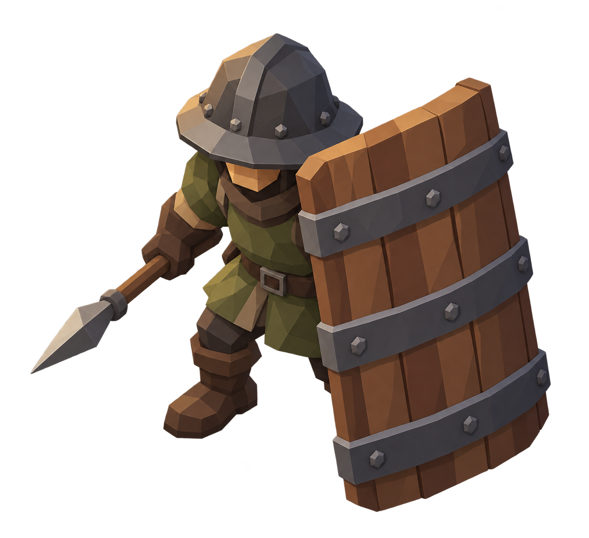
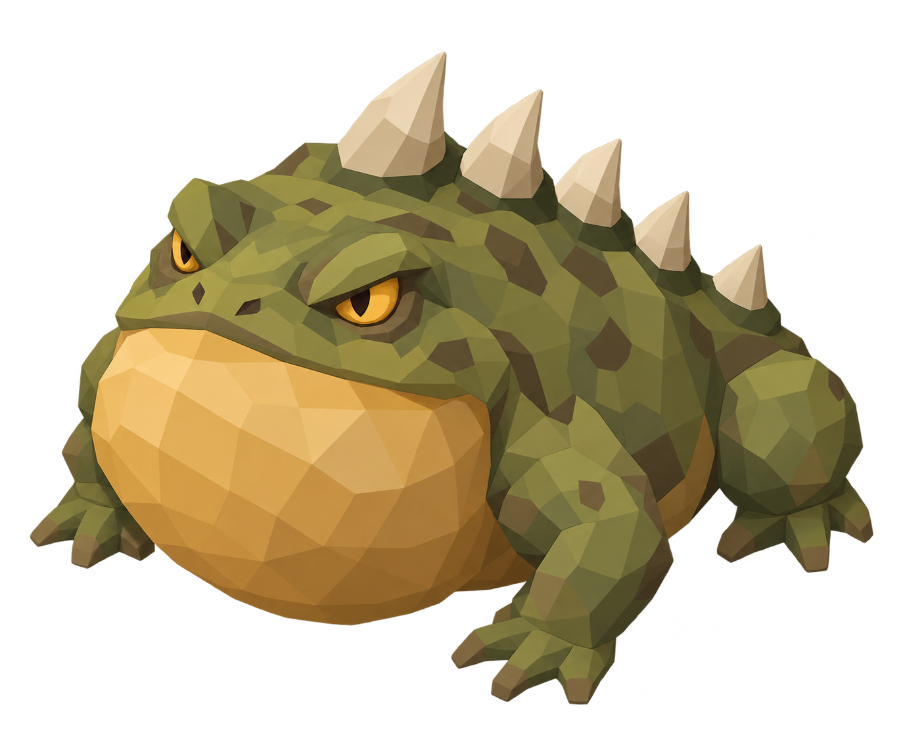
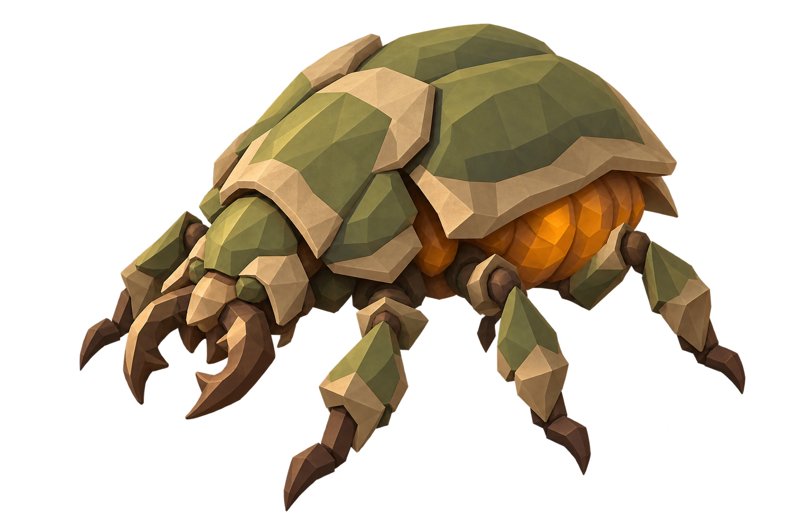
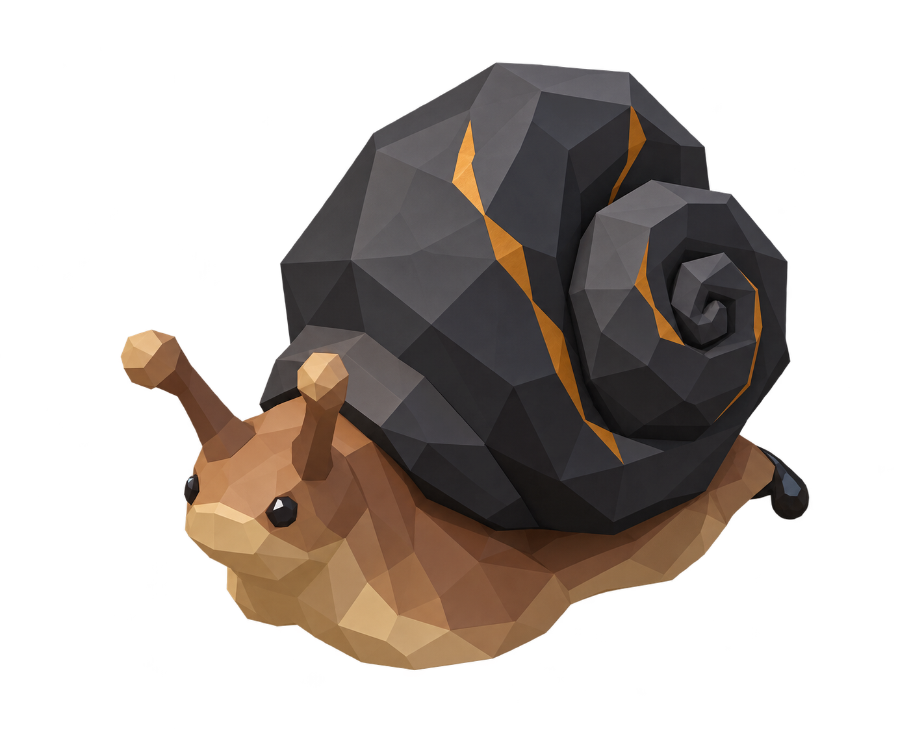
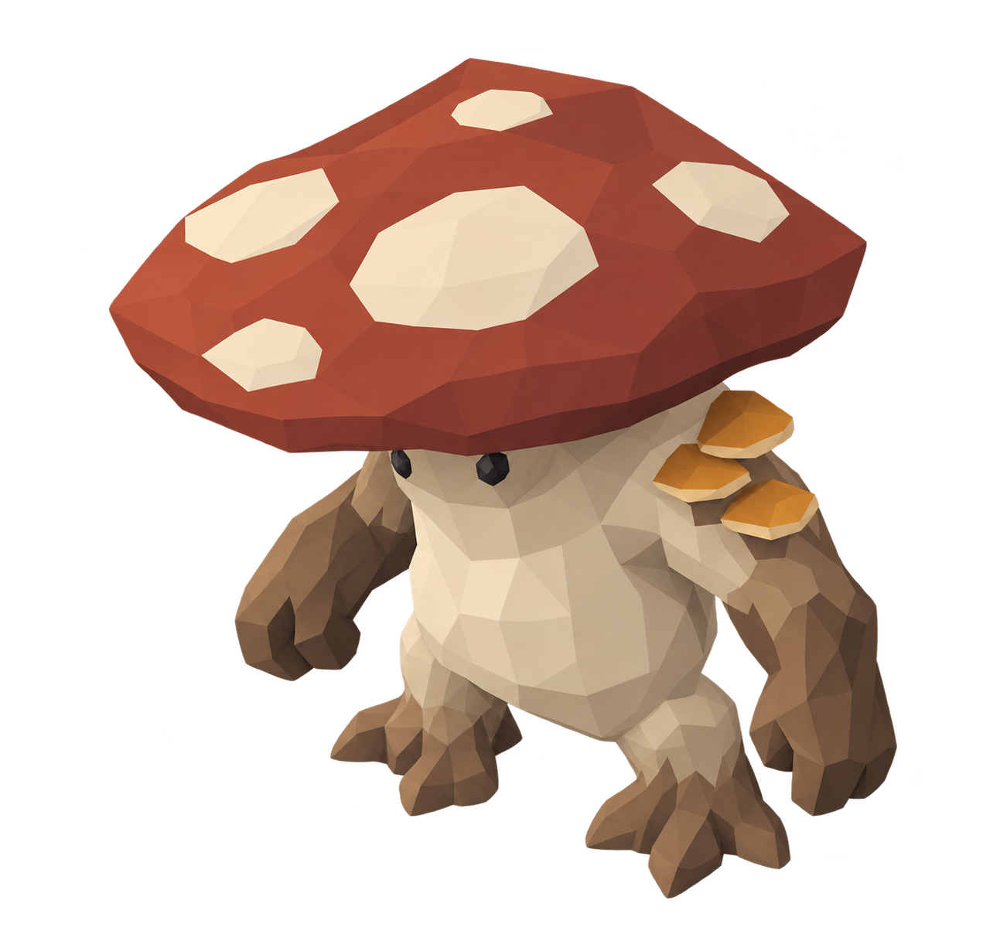
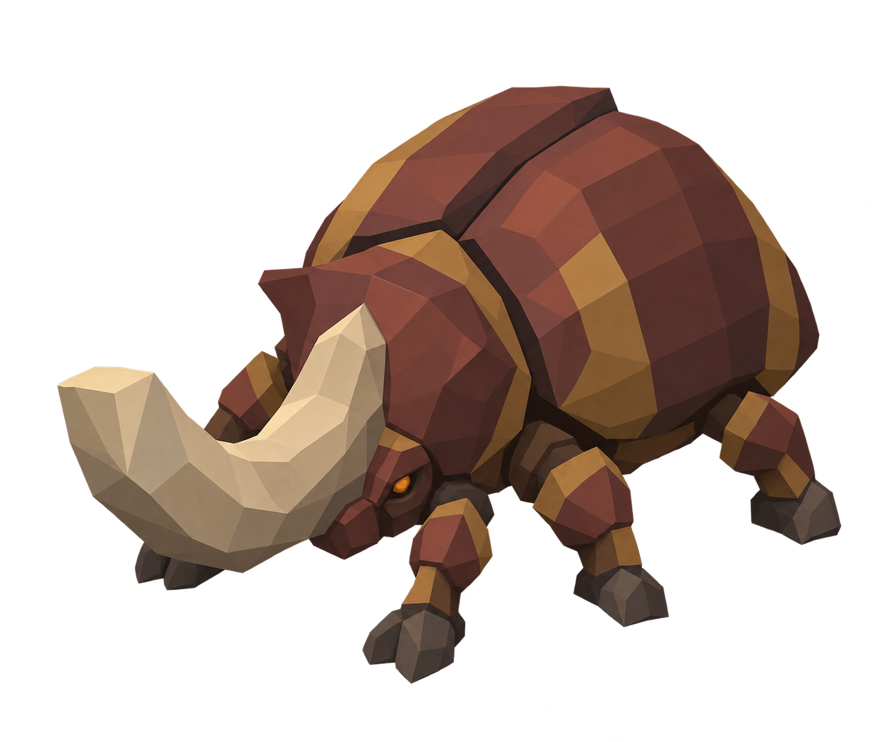

# AutoHex TD — Briefing: Gegner und Effekte

## Auftrag und Referenzen

Sechs Gegner für das Hex-Tower-Defense-Spiel neu gestalten. **Die beiliegenden ursprünglichen Konzeptbilder sind die visuelle Grundlage.** Die zuletzt generierten einfachen 3D-Modelle sind ausdrücklich keine Designreferenz und nicht Teil dieser Übergabe. Maskenläufer und Spiegelwächter entfallen vollständig.

Ziel: charmante, gut lesbare Fantasy-Figuren mit klaren Silhouetten, plastischen Materialien und dem Detailgefühl der Konzeptbilder. Für die isometrische Spielansicht und kleine Handybildschirme vereinfachen, ohne sie zu beliebigen Grundkörpern zu reduzieren. Auch von hinten und im Gegnerpulk müssen Typ und Zustand erkennbar bleiben. Farbe allein reicht zur Unterscheidung nicht.

## Gegner

### Schildknecht — ab Welle 6

Holzschild mit Eisenbändern, dunkler Helm, olivfarbene Kleidung und Speer. Schwerer, entschlossener Gang; Schild vor dem Körper führen, Speer und Arme mitbewegen.

**Vier klar unterscheidbare Schildzustände:**
1. **3 Treffer übrig:** kompletter, intakter Schild.
2. **2 Treffer übrig:** erste tiefe Risse, abgesplitterte Kanten, beschädigtes Band.
3. **1 Treffer übrig:** stark gebrochene Bretter, große fehlende Stücke, verbogenes Band.
4. **0 Treffer:** Schild zerbricht, anschließend kein Schild mehr; Armhaltung entsprechend ändern.

Pro direktem Treffer ein kurzer Holz-/Metallimpuls, Splitter sparsam und schnell ausblenden. Der Schild schützt vor drei direkten Treffern; Flächenschaden umgeht ihn. Keine zusätzlichen Lebensbalken für die Schildstufen nötig.

### Donnerkröte — ab Welle 13

Breiter olivgrüner Körper, warmer Kehlsack, goldene Augen und helle Rückendornen. Technischer Dateiname bleibt `thornToad`, Anzeigename **Donnerkröte**.

**Fortbewegung ausschließlich durch Sprünge.** Im Stand kein Gleiten und keine Laufbewegung. Animationsfolge: Ruhe/Atmung → deutliches Einfedern → Abstoß → sichtbarer Flug → Landung mit gestauchten Beinen. Zwischen Sprüngen stehen bleiben. Ab und zu auf eine nahe andere Lane oder einen späteren Straßenabschnitt im Nachbarhex springen, wenn das eine echte Abkürzung ist. Abkürzung durch Blickrichtung und etwas kräftigeres Ausholen ankündigen. Nicht teleportieren; nachvollziehbare Flugbahn und eindeutiger Landepunkt.

Aktuelle Umsetzung als Ausgangspunkt: 1,6 Sekunden je Zyklus, davon 0,7 Sekunden Sprung; jeder vierte Sprung kann eine passende Abkürzung nutzen, maximal etwa einen Hex-Mittelpunktabstand weit. Verlangsamung reduziert die Reichweite. Keine neue Blitzangriffsfähigkeit allein wegen des Namens erfinden.

### Häutungskäfer — ab Welle 17

Schwerer olivfarbener Panzer mit hellen Kanten, sechs Beine und bernsteinfarbene weiche Unterseite. Panzer und Innenkörper deutlich getrennt gestalten. Beine mit versetztem Insektengang animieren.

Wenn die Rüstung aufgebraucht ist: Panzer aufbrechen/abwerfen, weichen Körper sichtbar machen; danach dauerhaft 40 % schneller. Die Veränderung muss über Silhouette und Bewegung funktionieren. Kurze Splitteranimation, keine dauerhaft herumliegenden Trümmer.

### Pechschnecke — ab Welle 21

Warmer Schneckenkörper, dunkles spiraliges Haus mit goldenen Bruchlinien. Wellenförmiges Kriechen, leicht bewegliche Fühler, ruhiges Gewicht des Hauses.

**Pech liegt direkt auf dem Boden der Straße.** Dunkle, zäh glänzende, unregelmäßige Flecken zu einer Spur verbinden. Keine schwebenden Ringe, keine senkrechte Fläche und keine Scheibe über den Gegnern. An Fahrbahnhöhe und Kurven anpassen; nicht großflächig das ganze Hex überdecken. Kleine Glanzstellen und sparsame Blasen vermitteln Zähigkeit. Ränder dünn auslaufen lassen; kein Z-Fighting.

Die Schnecke hat achtmal die normalen Wellen-Lebenspunkte und nur 22 % der normalen Geschwindigkeit. Ihr Pech verlangsamt andere Gegner um 45 %, nicht die Schnecke selbst. Feuer entzündet es und schädigt Gegner. Brennendes Pech braucht niedrige Flammen/Glut auf derselben Fläche, einen deutlichen Zündimpuls und ein weiches Ausklingen. Normale Spur besteht aktuell 5 Sekunden, entzündete Spur 3 Sekunden.

### Pilzkoloss — ab Welle 28

Breiter roter Hut mit cremefarbenen Flecken, heller massiger Körper, kleine dunkle Augen und seitliche Baumpilze. Schwerer, leicht schwankender Gang; Hut soll Gewicht vermitteln.

Beim Tod eine **räumliche Sporen-/Rauchwolke** statt eines einfachen Rings. Kurzer Ausstoß unter dem Hut, dann mehrere überlappende weiche Wolken mit langsamer Drift, Aufstieg und vereinzelten Sporenpartikeln. Matte, leicht gelbgrüne/beige Farbwelt; nicht wie Feuerrauch oder eine Explosion aussehen lassen. Dichte Mitte, transparente Ränder, sanftes Auflösen. Straße, Türme und Gegner müssen durch die Wolke lesbar bleiben.

Die Wolke besteht 4 Sekunden. Gegner darin sind für Türme nicht anvisierbar, nach dem Verlassen sofort wieder. Flächenschaden und Fallen können sie weiterhin treffen. Wirkungsbereich und Restdauer sollen visuell verständlich sein, ohne den Bildschirm mit Text zu füllen.

### Rammbockkäfer — ab Welle 38

Roter schwerer Panzer mit goldenen Bändern, großes gebogenes helles Horn, sechs kräftige Beine. Silhouette deutlich bulliger als beim Häutungskäfer.

**Beschleunigung ausschließlich auf wirklich geraden Strecken.** In Kurven keine Beschleunigung, auch nicht auf einzelnen kurzen Segmenten einer geglätteten Kurve. Im Anlauf Kopf/Horn senken, Schritte schneller und kräftiger; Staub nur dezent. In Kurven Gewicht verlagern und Tempo sichtbar verlieren. Verlangsamung unterbricht den Anlauf. Bei vollem Tempo verursacht er 3 Basisschaden.

## Lieferung und technische Anschlussstellen

- Zuerst überarbeitete Farbsilhouetten/Ansichten der sechs Gegner sowie ein Effekt- und Zustandsblatt für Schild, Pech und Sporen abstimmen.
- Anschließend editierbare Blender-Dateien und GLB-Exporte mit Materialien und Animationen liefern. Originale Konzeptbilder als Referenz erhalten.
- Vorwärts +X, oben +Y, Ursprung am Boden. Vorhandene Gegner sind ungefähr 0,3–0,4 Modelleinheiten hoch. Finale Proportionen im Straßenmaßstab prüfen; keine übergroßen Fußabdrücke.
- Dateinamen: `enemy_shieldbearer.glb`, `enemy_thornToad.glb`, `enemy_moltingBeetle.glb`, `enemy_tarSnail.glb`, `enemy_mushroomColossus.glb`, `enemy_ramBeetle.glb`.
- Getrennte bewegliche Teile und austauschbare Schild-/Panzerzustände. Bestehender Renderer verwendet starre Gelenkgruppen `rig_*`; ein neues Skelett-Rig benötigt abgestimmte Renderer-Anpassungen.
- Benötigte Clips: Idle und jeweilige Fortbewegung, Kröte Einfedern/Jump/Land, Käfer Charge, Schild Hit/Break, Häutung sowie Death. Bodenkontakt, geschlossene Schleifen und keine seitlichen Sprünge am Clipwechsel prüfen.
- Performance: geringe Materialanzahl, mobile-taugliche Geometrie; transparente Effekte begrenzen. Effekte sowohl einzeln als auch mit mehreren Gegnern testen.
- Abnahme: lesbar in Spielgröße aus allen Kamerarichtungen, keine gleitenden Füße in Ruhephasen, Pech auf der Fahrbahn, erkennbare Schildstufen, transparente Sporenwolke, nachvollziehbare Krötensprünge.

Dieses Paket enthält ausschließlich die ursprünglichen PNG-Konzeptbilder und dieses Briefing, keine vereinfachten 3D-Modelle und keine Accountdaten.
