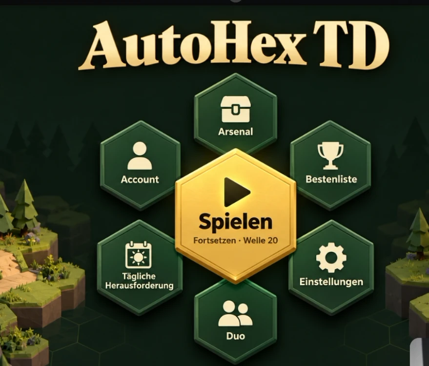
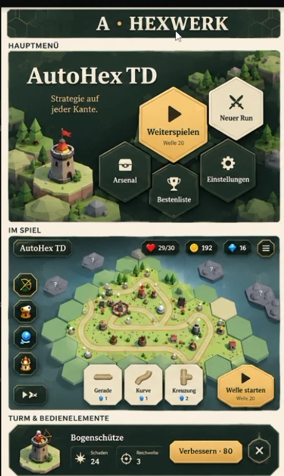
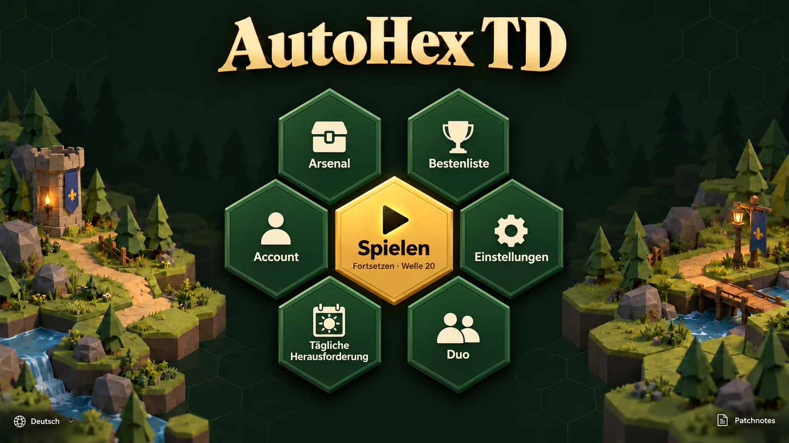
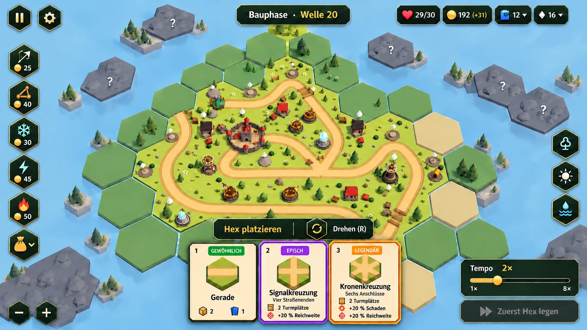
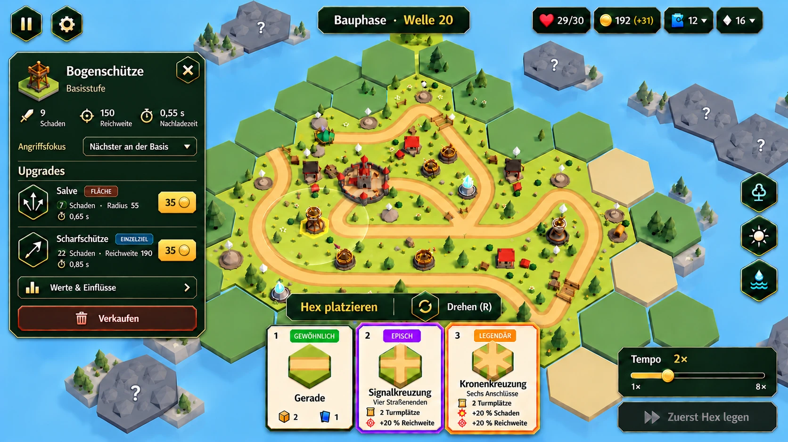
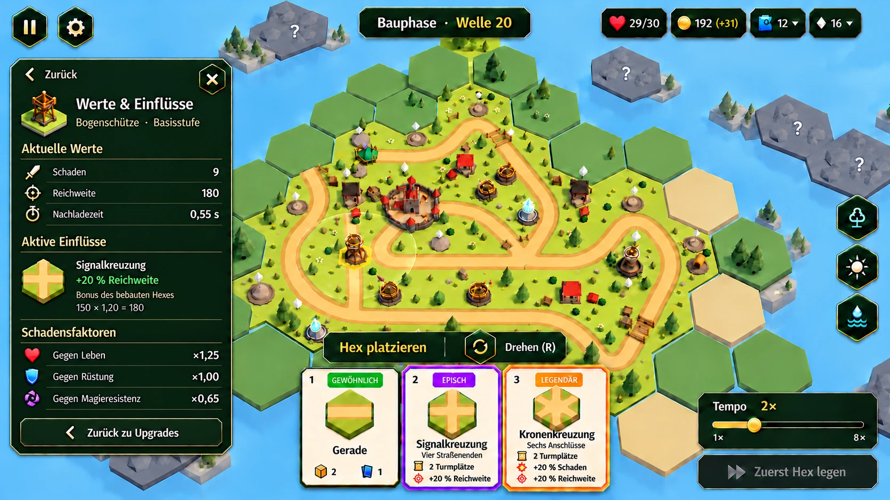

# AutoHex TD — Briefing: Hex-Oberfläche „Hexwerk“

Stand: 21.10.2026 · Branch `menudesign`

> Der erste Export (`assets/uidesign/`) ist eingebaut. Was noch fehlt, steht in [NACHLIEFERUNG.md](NACHLIEFERUNG.md).

## Auftrag und Referenzen

Die gesamte Oberfläche bekommt eine eigene Formensprache: **Jede Aktion ist ein Hex.** Ausgangspunkt ist das neue Hauptmenü mit einem großen goldenen Hex in der Mitte und sechs Hexen darum („Hex-Blüte“). Danach folgt der Spielbildschirm mit HUD, Turmfenster und Handkarten im selben Stil (Abschnitt „Spielbildschirm“).








Die Bilder sind **Stimmungsreferenzen**, keine Pixelvorlage. Übernehmen: dunkles Waldgrün, plastische Hex-Kacheln mit hellem Rand und dunkler Rille, warmes Gold für genau eine Hauptaktion, cremefarbene Spielkarten, Nebel-Hexe mit „?“ für Unentdecktes, Diorama-Hexinseln mit Bäumen und Wegen. Nicht übernehmen: eingebackene Texte, zu kleine Beschriftungen, Effekte, die auf Handys unlesbar werden.

**Zielbild ist das dritte Bild:** Wortmarke oben, sechs Hexe Kante an Kante in gleichmäßigem Kreis um den Gold-Hex, links und rechts je eine Diorama-Insel, Sprache unten links, Patch Notes unten rechts.

Die Blüte ist im Branch bereits mit CSS-Platzhaltern umgesetzt (Verläufe statt Grafiken). Eure Grafiken ersetzen diese Ebenen später 1:1; Layout, Texte und Bedienung bleiben im Code. Die Konzeptseite `docs/hex-ui-konzept-2026-10-21/index.html` zeigt alle Bildschirme, Zustände und Farben.

## Feste technische Vorgaben

- **Hex-Form:** spitze Oberseite („pointy top“), Seitenverhältnis Breite : Höhe = **0,866 : 1**. Arbeitsvorlage 866 × 1000 px.
- **Keine Schrift in Grafiken.** Das Spiel ist zweisprachig (DE/EN), Texte setzt der Code. Ausnahme: die Wortmarke.
- **Sicherheitszone für Inhalte:** mittig 70 % der Breite und 55 % der Höhe frei von Ornamenten.
- **Kleinste Darstellung:** Ring-Hex auf 320-px-Handys etwa 80 × 92 px. Rahmen und Icons müssen dort noch klar wirken; Details dürfen bei kleiner Größe wegfallen.
- **Fokus:** Tastaturfokus ist ein heller Rand in `#ffe198`. Der Rahmen muss sich dafür umfärben lassen (getrennte Ebene oder einfarbiges SVG).
- **Farbe allein reicht nie.** Gesperrt, aktiv und verfügbar unterscheiden sich zusätzlich durch Icon, Text oder Form.
- **Formate:** UI-Elemente und Icons als **SVG** (bevorzugt, mit `currentColor` wo einfarbig). Gemalte Flächen als **WebP + PNG @2x** mit transparentem Hintergrund. 3D als **GLB** plus editierbare Blender-Datei.

## Lieferliste

### P1 — für das Hauptmenü (dieser Branch)

| # | Element | Inhalt | Format |
| --- | --- | --- | --- |
| 1 | **Wortmarke „AutoHex TD“** | Prägestil wie Referenz: goldene Serifenschrift, dunkle Kontur, leichte Plastizität. Varianten: voll (Desktop), kompakt (Handy/Querformat), einfarbig hell. Ohne Hintergrund. | SVG + PNG @2x |
| 2 | **Hex-Rahmen in 4 Farbfamilien** | Gold (Hauptaktion), Grün (Navigation), Creme (zweite Spielaktion/Karten), Nebel (gesperrt/unentdeckt). Je **getrennte Ebenen:** Außenrand, Rille, Füllung, Glanzlicht. | SVG (je Ebene eine Datei oder benannte Gruppen) |
| 3 | **Zustände pro Rahmen** | normal, Hover (heller), gedrückt (tiefer), Fokus (Rand `#ffe198`), deaktiviert. Für Nebel zusätzlich „?“-Variante. | SVG oder Farbangaben je Ebene |
| 4 | **Menü-Icons** | Spielen, Neuer Run, Arsenal (Truhe), Bestenliste (Pokal), Account, Duo, Tägliche Herausforderung, Einstellungen, Patch Notes, Sprache, Schloss, „Upgrade verfügbar“-Abzeichen (◆). Gefüllt, eine Farbe, 24-px-Raster. | SVG |
| 5 | **Menü-Diorama** | Zwei Hexinseln links und rechts, Details siehe Abschnitt „Menü-Hintergrund“. | GLB + Blender, dazu WebP-Rückfall |

## Menü-Hintergrund: Diorama aus unseren Kacheln

**Vorhandener Stand im Branch:** `classes/menu-diorama.mjs` baut beide Inseln schon jetzt aus den echten Spielmodellen (Kacheln, Türme, Gebäude, Landmarken). Straßen schließen sauber an, die Mitte bleibt frei. Das ist die Bühne. Eure Aufgabe ist, sie wie im Zielbild **lebendig und reich** zu machen, **im Stil unserer Kacheln** (Low-Poly, weiche Farbflächen, keine Fototexturen).

**Aufbau, den wir brauchen:**
1. **Inselsockel:** Unter jeder Insel ein Klippen-/Erdkörper mit Felsstufen, damit die Kacheln nicht als flache Platten schweben (wie im Zielbild: braune Erdkante, graue Felsen, Grasüberhang). Ein Modell pro Insel, Oberkante exakt auf Kachelhöhe 0.
2. **Deko-Set als Einzel-GLBs**, frei platzierbar zwischen den Kacheln: 3 Nadelbäume (klein/mittel/groß), 2 Laubbäume, Büsche, Grasbüschel, Blumen, 3 Felsen, Holzzaun-Stücke, Fackel/Laterne mit Glühen, Banner mit Wappen, Holzbrücke, Wasserlauf-Kachel mit Wasserfall-Kante.
3. **Wasser:** Bach als eigene Kachel (`tile_river_straight`, `tile_river_curve`) und Wasserfall-Abschluss an der Inselkante. Leicht animierte Oberfläche (UV-Scroll oder Shapekey), auch als ruhige Fassung.
4. **Licht und Stimmung:** warmes Seitenlicht von vorne rechts, kühles Gegenlicht. Lampen und Fackeln als Emissive-Material, damit sie im dunklen Grün leuchten.
5. **Editionen:** dieselben Deko-Teile als Sakura- (Kirschblüten, Laternen) und Halloween-Varianten (Kürbisse, kahle Bäume), gleiche Dateinamen im Editionsordner.

**Bildaufbau:** Kamera wie im Spielmenü (Blick schräg von oben, etwa 36° Neigung). Inseln füllen die äußeren 30 % links und rechts und laufen unten aus dem Bild. Die mittleren 40 % bleiben **dunkel und ruhig**: nur das Wabenmuster, keine hellen Objekte hinter der Blüte. Kein Objekt höher als ein Turm, damit nichts in die Wortmarke ragt.

**Grenzen:** je Insel höchstens etwa 15.000 Dreiecke und 4 Materialien; keine Texturen über 1024 px. Der Hintergrund läuft auch auf Steam Deck und Handys.

**Rückfall:** ein gerendertes WebP der fertigen Szene in 2560 × 1440 (quer) und 1170 × 2532 (hoch), für Geräte ohne WebGL und als Ladebild.

## Spielbildschirm

Zielbild sind die drei In-Game-Referenzen: Bauphase, geöffnetes Turmfenster und die Unteransicht „Werte & Einflüsse“. Auch sie sind Stimmungsreferenzen. Zahlen, Turmnamen und Kartentexte darin sind Beispiele; die echten Werte setzt der Code.

**Grundsätze**
- **Das Spielfeld ist die Bühne.** Es bleibt die hellste und farbigste Fläche. Alle Bedienelemente liegen als dunkelgrüne Elemente am Rand und lassen die Mitte frei.
- **Drei Bausteine:** Hex-Knöpfe für Aktionen (Pause, Einstellungen, Türme, Biome, Zoom), dunkle Kapseln für Werte (Leben, Gold, Deck, Diamanten), dunkelgrüne Paneele mit feiner Goldkante für Fenster (Turmfenster, Tempo, Wellenstart).
- **Gold bedeutet „hier kannst du handeln“:** Phase und Welle im Kopfschild, Preise, bezahlbare Upgrades, der bereite Wellenstart. Was gerade nicht geht, ist grau und nennt den Grund im Element selbst („Zuerst Hex legen“).
- **Handkarten sind Spielmaterial:** cremefarbene Karten, deren Rahmenfarbe die Seltenheit zeigt. Die Seltenheit steht zusätzlich als Text im Abzeichen.

### Bildschirmzonen

| Zone | Inhalt | Verhalten |
| --- | --- | --- |
| Oben links | Hex-Knöpfe **Pause** und **Einstellungen** | Einstellungen öffnet das bestehende Einstellungsmenü (auch per Escape). |
| Oben Mitte | **Phasenschild**: „Bauphase · Welle 20“, im Kampf „Welle 20 · Gegner übrig“, bei Bosswellen eigene Variante | Breite passt sich dem Text an, beide Sprachen. |
| Oben rechts | **Ressourcen-Kapseln**: Leben (Herz, „29/30“), Gold mit Einkommensvorschau („192 (+31)“), Deck mit Kartenanzahl, Diamanten | Deck und Diamanten haben einen kleinen Pfeil und öffnen die vorhandenen Infofenster. |
| Linker Rand | **Turmleiste**: senkrechte Hex-Knöpfe mit Turm-Icon, darunter Goldpreis als kleine Plakette; ganz unten der Beutel für **Hilfen** (Verbrauchsgegenstände) mit Pfeil | Zustände: bezahlbar, zu teuer (Preis rot/grau), ausgewählt (Goldrand), gesperrt (Schloss). Ziehen auf einen Bauplatz baut, wie bisher. |
| Rechter Rand | **Biomleiste**: Hex-Knöpfe der entdeckten Biome (z. B. Wald, Wüste/Sonne, Wasser) | Antippen zeigt die Biom-Effekte. |
| Unten links | **Zoom** − und + als Hex-Knöpfe | Nur auf Geräten ohne Mausrad/Pinch zwingend sichtbar. |
| Unten Mitte | **Aktionsleiste** „Hex platzieren · Drehen (R)“ über den **Handkarten** (3, bei zwei Fronten 5) | Erscheint nur, wenn eine Karte gewählt ist. Drehen bleibt mindestens 44 px hoch (Touch). |
| Unten rechts | **Tempo-Paneel** (Schieberegler 1×–8×, aktueller Wert in Gold) und darunter **Wellenstart** | Wellenstart gesperrt: grau mit Grund („Zuerst Hex legen“). Bereit: Gold „Welle starten“ mit Leertaste-Hinweis. Läuft: zeigt den Wellenfortschritt. |
| Kartenrand | **Unentdeckte Felder** als graue Felsinseln mit „?“ | Gehören zur 3D-Welt, siehe unten. |

**Turmfenster und Gebäudefenster** docken links an, über der Turmleiste. Auf schmalen Bildschirmen werden sie zu einem Blatt unten links. Sie dürfen Handkarten, Wellenstart und Ressourcen nie verdecken (der Code rechnet diese Flächen als reserviert).

### Turmfenster (Referenz 2)

1. **Kopf:** Porträt des Turms auf einem Hex-Sockel, Name in der Titelschrift, darunter die Stufe („Basisstufe“, „Stufe 2“, Ultimate). Schließen als kleiner Hex-Knopf mit ×.
2. **Kernwerte** als Reihe aus drei Icons mit Zahl und Beschriftung: Schaden, Reichweite, Nachladezeit. Für Auren, Minen und Gebäude andere Werte, gleiche Optik.
3. **Angriffsfokus** als Dropdown im Paneel-Stil (z. B. „Nächster an der Basis“).
4. **Upgrades:** pro Pfad eine Zeile mit Hex-Icon, Name, farbigem **Typ-Chip** („Fläche“, „Einzelziel“, …), zwei Kurzwerten und dem **Preis-Knopf** (Gold mit Münze). Zustände des Preis-Knopfs: bezahlbar, zu teuer (grau, Preis bleibt lesbar), gesperrt (Schloss und Bedingung), bereits gewählt.
5. **„Werte & Einflüsse ›“** als Zeile mit Diagramm-Icon. Sie öffnet die Unteransicht im selben Paneel, nicht in einem neuen Fenster.
6. **Verkaufen** als dunkelroter Knopf mit Mülleimer, über die volle Breite. Er bleibt zweistufig: Der erste Klick zeigt „Wirklich verkaufen? +Erstattung“, erst der zweite verkauft.

### Werte & Einflüsse (Referenz 3)

Unteransicht im Turmfenster. Oben „‹ Zurück“, Titel und Turm/Stufe, darunter drei Abschnitte:
- **Aktuelle Werte** als Tabelle mit Icon, Bezeichnung und Wert, rechtsbündig.
- **Aktive Einflüsse:** pro Einfluss ein Kärtchen mit der Hex-Illustration der Quelle (Kachel, Gebäude, Biom), dem Bonus in Grün und der Rechnung („150 × 1,20 = 180“). Mali erscheinen in Rot mit Minuszeichen.
- **Schadensfaktoren** gegen Leben, Rüstung und Magieresistenz mit eigenen Icons (Herz, Schild, Wirbel).

Unten „‹ Zurück zu Upgrades“ als Umrissknopf.

### Handkarten (Referenz 1)

- Cremefarbene Karte im Hochformat mit **Tastennummer** oben links (1–3 bzw. 1–5) und **Seltenheits-Abzeichen** oben mittig: Gewöhnlich (Grün), Selten (Blau), Episch (Violett), Legendär (Orange). Der Kartenrand hat die gleiche Farbe.
- In der Mitte die **Hex-Illustration** des Straßenstücks von schräg oben, darunter Name und kurze Unterzeile („Vier Straßenenden“).
- Darunter bis zu drei **Bonuszeilen** mit Icon (Turmplätze, +Schaden, +Reichweite, Gold). Bei einfachen Karten stattdessen eine Fußzeile mit zwei Kennzahlen.
- Zustände: normal, Hover (hebt sich), gewählt (angehoben, Goldrand, Aktionsleiste erscheint), nicht platzierbar (abgedunkelt mit Grund).
- Die Hex-Illustrationen **rendern wir selbst** aus den vorhandenen Kachel-Modellen (über 40 Kacheltypen). Ihr liefert dafür nur Kamerawinkel, Licht und eine Beispiel-Illustration als Stilvorlage.

### 3D-Welt rund um das Spielfeld

- **Unentdeckte Felder** (heute `tile_fog`) als graue, kantige Felsinseln mit ein paar Nadelbäumen und einem großen hellen „?“. Lesbar auch aus großer Kameraentfernung, je Edition eine Variante.
- **Umgebung:** helles Blau statt Leere, wie Wasser oder Himmel unter schwebenden Inseln. Kleine Felsinseln mit Bäumen als Deko im Außenbereich, sparsam, ohne Spielbedeutung.
- **Kachelseiten:** helle Erd- und Felskanten unter jeder Kachel, damit das Spielfeld wie ein Diorama wirkt. Im gleichen Stil wie die Menüinseln.

### P2 — Lieferliste Spielbildschirm

| # | Element | Inhalt | Format |
| --- | --- | --- | --- |
| 6 | **Paneel-Rahmen** | Dunkelgrünes Paneel mit feiner Goldkante und leicht abgeschrägten Ecken, für Turmfenster, Tempo und Wellenstart. Varianten: normal, hervorgehoben. | SVG oder 9-Slice-PNG @2x |
| 7 | **Ressourcen-Kapseln** | Kapsel für Icon + Zahl, Variante mit Dropdown-Pfeil. Zahlen setzt der Code. | SVG |
| 8 | **Phasenschild** | Schild oben mittig; Varianten Bauphase, Kampf, Bosswelle. | SVG |
| 9 | **Kleiner Hex-Knopf** | 56–64 px für Pause, Einstellungen, Zoom, Biome und Turmleiste. Vereinfachte Fassung der P1-Rahmen; Zustände wie P1 plus „ausgewählt“. | SVG |
| 10 | **Preis-Plakette und Preis-Knopf** | Plakette unter Turmleisten-Hexen (Münze + Zahl) und Gold-Knopf im Turmfenster; Zustände bezahlbar, zu teuer, gesperrt. | SVG |
| 11 | **Tempo-Regler** | Schiene, Füllung, Griff, Skalenbeschriftung 1×–8×. | SVG |
| 12 | **Wellenstart** | Breiter Knopf mit Doppelpfeil; Zustände gesperrt, bereit (Gold), läuft (Fortschritt). | SVG-Ebenen |
| 13 | **Aktionsleiste** | Zweigeteilte Kapsel „Hex platzieren · Drehen“ mit Dreh-Icon im Hex. | SVG |
| 14 | **Handkarten-Rahmen** | Cremekarte in 4 Seltenheitsfarben, Seltenheits-Abzeichen, Nummernfeld, Zustände normal/Hover/gewählt/gesperrt. | SVG |
| 15 | **Turmfenster-Bausteine** | Porträt-Sockel (siehe 18), Dropdown, Typ-Chips (Fläche, Einzelziel, Aura, Kette, Frost …), Listen-Trenner, Verkaufen-Knopf (normal, Bestätigung), Umrissknopf „Zurück“. | SVG |
| 16 | **HUD- und Werte-Icons** | Pause, Einstellungen, Leben, Gold, Diamant, Deck, Hilfen (Beutel), Zoom ±, Drehen, Wellenstart, Schaden, Reichweite, Nachladezeit, Fläche, Einzelziel, Werte (Diagramm), Verkaufen (Mülleimer), Zurück, Schließen, Turmplatz, Gegen Leben, Gegen Rüstung, Gegen Magieresistenz, Biome (Gras, Wüste, Sturm, Asche, Wasser). | SVG, 24-px-Raster |
| 17 | **Nebelfeld und Umgebung** | Felsinsel mit „?“ als Ersatz für `tile_fog`, Deko-Felsinseln, Kachelseiten; Normal, Sakura, Halloween. | GLB + Blender |

### P3 — Turm-Identität und Modusauswahl

| # | Element | Inhalt | Format |
| --- | --- | --- | --- |
| 18 | **Turm-Porträt-Sockel** | Hex-Sockel (Stein, Gras, Kante), auf den wir die vorhandenen Turmmodelle setzen. Porträts **rendern wir selbst** aus den GLBs; ihr liefert Sockelmodell, Kamerawinkel und Licht. | GLB + Blender |
| 19 | **Turm-Icons im Hexstil** | 9 Türme: Bogenschütze, Katapult, Kettenblitz, Frost, Minenleger, Balliste, Flamme, Element, Nekromant. Dazu Upgrade-Pfade (z. B. Salve, Scharfschütze) und Gebäude: Haus, Schmiede, Markt. Eindeutige Silhouetten, auch in 24 px. | SVG |
| 20 | **Modus-Illustrationen** | Drei Bildmotive im Hex-Ausschnitt: Standardspiel, Tägliche Herausforderung, Duo. | WebP 800 × 924, transparent |

### Schrift

Vorschlag (alle SIL Open Font License, für Steam und Web frei nutzbar): **Fraunces Black** für Wortmarke und Überschriften, **Barlow Semi Condensed** (600/700) für Hex-Beschriftungen und Bedienelemente. Alternative mit kantigen, facettierten Serifen: **Grenze ExtraBold**. Die Wortmarke bitte auf Basis der gewählten Titelschrift zeichnen (Prägung, Kontur, Glanz) und als Vektor liefern. Vergleich auf der Konzeptseite, Abschnitt „Schrift“.

### Optional: Bewegung und Ton

Vorschläge für Hover/Druck (Dauer, Kurve), sanftes Glühen der Gold-Hexe, Öffnen der Blüte beim Start. Klickgeräusche (Holz/Stein), leise Menü-Atmosphäre. Alle Animationen müssen bei „Bewegung reduzieren“ abschaltbar sein.

## Dateinamen

```
assets/ui/brand/wordmark_full.svg, wordmark_compact.svg, wordmark_mono.svg
assets/ui/hex/hex_{gold|green|cream|fog}_{rim|groove|fill|shine}.svg
assets/ui/icons/icon_{play|newRun|arsenal|leaderboard|account|duo|daily|settings|patchNotes|language|lock|close|back|...}.svg
assets/ui/menu/menu_bg_{landscape|portrait}.webp, menu_island_{left|right}.webp, menu_fog.webp
assets/ui/hud/panel_{normal|highlight}.svg, capsule.svg, capsule_dropdown.svg, phase_{build|wave|boss}.svg
assets/ui/hud/hex_small_{normal|hover|pressed|selected|disabled}.svg, price_tag.svg, price_button_{ready|expensive|locked}.svg
assets/ui/hud/speed_{track|fill|knob}.svg, wave_start_{locked|ready|running}.svg, action_bar.svg, sell_{normal|confirm}.svg
assets/ui/cards/card_frame_{common|rare|epic|legendary}.svg, card_badge.svg
assets/ui/icons/icon_{damage|range|cooldown|area|single|stats|vsHealth|vsArmor|vsMagic|towerSlot|consumables|zoomIn|zoomOut|rotate|...}.svg
assets/ui/towers/icon_tower_{archer|catapult|chain|freeze|mine|ballista|flame|element|necromancer}.svg
assets/tiles/tile_fog.glb (Felsinsel mit „?“), assets/decor/decor_{rockIsle|tree|rock|...}.glb
```

Interne Turm-IDs bleiben unverändert (`archer`, `chain` usw.), auch wenn der Anzeigename anders lautet.

## Abnahme

- Alle P1-Elemente in einer Testdatei zusammen ansehen (Hauptmenü bei 320 × 568, 390 × 844, 844 × 390, 1440 × 900).
- Spielbildschirm als Mockup bei 1920 × 1080, 1280 × 800 (Steam Deck), 844 × 390 und 390 × 844, jeweils mit geöffnetem Turmfenster und fünf Handkarten. Nichts verdeckt Handkarten, Wellenstart oder Ressourcen.
- Längste Texte prüfen: „Kronenkreuzung“, „Nächster an der Basis“, „Gegen Magieresistenz“, jeweils auch in der englischen Fassung.
- Texte in Deutsch und Englisch passen ohne Verkleinerung unter 12 px.
- Kontrast Text/Fläche mindestens 4,5 : 1; Gold-Hex mit dunkler Schrift, Grün mit heller Schrift.
- Editierbare Quelldateien (Figma/Illustrator/Blender) gehören zur Lieferung.
